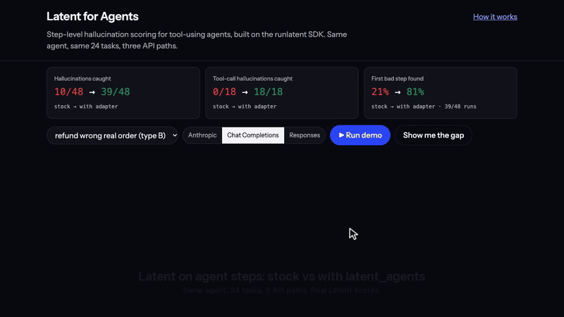

# Latent for Agents

[Latent](https://runlatent.ai/) scores each LLM answer for hallucination with one line, `runlatent.auto_instrument()`. Agents make that harder. Many agent turns are only tool calls, and those are never scored. Earlier tool calls are removed from the history the reader sees. On the OpenAI Responses API, the tool results don't reach the reader at all. This repo measures that on a small order-support agent across three API paths, then adds a thin adapter on top of the SDK, `latent_agents`. The adapter scores tool calls, gives answers their tool results as source, and points at the first step that went wrong.

**Full write-up: [results/findings.md](results/findings.md)**

[](docs/demo/demo-final.mp4)

*Captioned video: [docs/demo/demo-final.mp4](docs/demo/demo-final.mp4). Re-record after UI changes with `reshoot run demo/reshoot.toml`.*

## Results (24 scenarios × 3 API paths, real Latent API, planted hallucinations)

| | Stock `auto_instrument()` | Stock + `context()` | With `latent_agents` |
|---|---|---|---|
| Planted hallucinations caught | 10/48 (21%) | 10/48 | **39/48 (81%)** |
| Tool-argument hallucinations caught | 0/18 | 0/18 | **18/18** |
| First bad step located | 10/48 | 10/48 | **39/48** |
| Clean runs with a false alarm | 5/24 (all on Responses) | 5/24 | **0/24** |

Caught per path: stock got 3/16 on Anthropic, 6/16 on Chat Completions and 1/16 on Responses. The adapter got 13/16 on each path. Overhead is about 255 ms per scored step.

## `latent_agents` usage

```python
from latent_agents import to_steps, score_trajectory, rollup
steps = to_steps(messages, "responses")          # or "chat" / "anthropic"
scored = score_trajectory(steps, session_id="ticket-42")
print(rollup(scored))  # {'risk': ..., 'first_bad_step': 3, 'reason': 'Agent called `issue_refund` with order_id `A-1366`, ...'}
```

It uses only the public SDK (`runlatent.check()`). Tool calls are flagged when an argument value appears nowhere in the user turns or earlier tool results. An amount at or below an order total counts as grounded.

## Architecture

```
scenarios.yaml ──► agent/run.py (3 loops) ──► real openai / anthropic client ──► agent/stub_server.py (scripted turns)
                         │                           │
                         │                    runlatent.auto_instrument()  ──► Latent API   (stock)
                         ▼
                latent_agents.to_steps ──► score_trajectory ──► runlatent.check() ──► Latent API   (adapter)
                         │
                         ▼
   runs/results.jsonl ──► scripts/eval.py ──► results/metrics.json, web/demo_data/demo.json ──► web/ + demo/ CLI
```

## Run it

```bash
python3.12 -m venv .venv && .venv/bin/pip install -r requirements.txt
```

```bash
.venv/bin/uvicorn app.main:app --port 8765
```

Open http://localhost:8765. Replay mode needs no keys. "Show me the gap" plays the three tour scenarios. Click any step to see exactly what Latent saw. Add `?record=1` for a fixed 1280×720 recording layout. With `LATENT_API_KEY` in `.env`, a **Run live** button appears. Set `DEMO_PASSWORD` to put the whole site behind basic auth.

```bash
.venv/bin/python -m demo --scenario refund_wrong_real_order --path chat
```

To reproduce from scratch: put `LATENT_API_URL` and `LATENT_API_KEY` in `.env`. `scripts/run_all.py` is cached, so delete `runs/results.jsonl` first to rerun. The full matrix uses about 315 scored answers.

```bash
.venv/bin/python scripts/run_all.py && .venv/bin/python scripts/eval.py && .venv/bin/python test_latent_agents.py
```

## Limitations

- The hallucinations are planted and the model turns are scripted. No LLM spend; the real SDK capture path is still used.
- The tools are mocks, n is small (read the raw counts), and only the free plan and hosted reader were used.
- Provenance checks only arguments that contain an ID or a number.

Deploy: `render.yaml` (free web service, replay mode, set `DEMO_PASSWORD`).
